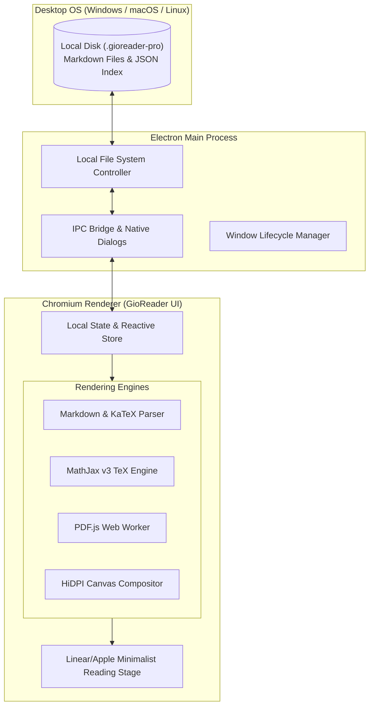

# GioReader Pro 📖⚡

[](LICENSE)
[](https://github.com/GioGorkem/gioreader-pro)
[](https://www.electronjs.org/)
[](https://www.mathjax.org/)
[](https://mozilla.github.io/pdf.js/)

> **A high-performance, distraction-free desktop reader engineered for rigorous academic engineering coursework, complex LaTeX mathematical typesetting, and ultra-high-definition PDF slide exploration.**

---

## 🎯 Overview & Philosophy

Modern engineering education involves reading dense lecture notes filled with complex mathematical formulas, multi-megabyte vector slide decks, and code implementations. Mainstream document readers and web applications often suffer from:
* Clunky PDF rendering that loses sharpness when zoomed in on high-DPI displays.
* Inability to seamlessly blend Markdown lecture explanations with native LaTeX math and supplementary PDF problem sets.
* Heavy browser overhead, cloud lock-in, and distraction-heavy interfaces.

**GioReader Pro** was conceived and architected as a **local-first, ultra-responsive desktop application** that provides students and researchers with an Apple Books / Linear-grade reading environment for demanding subjects like *Data Structures, Discrete Mathematics, Differential Equations, and Electrical Circuits*.

---

## ✨ Key Architectural Features

### 🔍 1. Ultra-HD HiDPI Canvas & Zoom Engine
* **Vector-Grade Sharpness:** Incorporates a custom device-pixel-ratio supersampling renderer over PDF.js, rendering pages with zero pixelation from **25% up to 800% zoom**.
* **120 FPS Compositor:** Smooth two-finger touchpad pinch-to-zoom and frictionless panning with anchor-point preservation (zooms precisely where your cursor points).

### 📐 2. Deep Mathematical Typography (LaTeX / MathJax v3)
* **Academic Caliber Typesetting:** Native support for inline (`$...$`) and display (`$$...$$`) mathematical typesetting powered by MathJax v3 and KaTeX compatibility.
* **Equation Numbering & Alignments:** Clean rendering of complex equation arrays, matrices, integrals, summations, and formal discrete logic symbols.

### 🌳 3. Hierarchical Course Tree & Supplementary Problem Sets
* **Structured Learning:** Organizes comprehensive university curricula into nested Courses $\to$ Units $\to$ Parts.
* **Supplementary Tree:** Allows linking problem sets, exam questions, and sample exercise PDFs directly under core units without corrupting the linear lecture sequence.

### 💾 4. Local-First & Zero Lock-In Storage Architecture
* All study notes, metadata, and reading progress are stored locally on the user's disk as clean, standard Markdown (`.md`) and lightweight JSON indices.
* Capable of instantaneously indexing and querying massive libraries containing **hundreds of parts and nearly a million words** with zero UI latency.

---

## 🏛️ System Architecture



---

## 🛠️ Tech Stack

* **Core Shell:** [Electron](https://www.electronjs.org/) (Multi-process architecture, context isolation, zero remote vulnerability)
* **Frontend:** Vanilla modern ES6+ (Zero bloated framework runtime, 60–120 FPS render loops)
* **Document Engines:**
  * [PDF.js](https://mozilla.github.io/pdf.js/) with dedicated Web Workers and standard font maps.
  * [MathJax v3](https://www.mathjax.org/) for vector-sharp LaTeX rendering.
* **Styling:** Custom CSS design system adhering to modern editorial typography standards (Paper, Warm, Dark, and Contrast modes).

---

## 🚀 Getting Started

### Prerequisites
* [Node.js](https://nodejs.org/) (v18.0.0 or higher recommended)
* `npm` or `yarn`

### Installation

1. **Clone the repository:**
   ```bash
   git clone https://github.com/GioGorkem/gioreader-pro.git
   cd gioreader-pro
   ```

2. **Install dependencies:**
   ```bash
   npm install
   ```

3. **Launch the application in development mode:**
   ```bash
   npm start
   ```

4. **Build standalone production executable:**
   ```bash
   npm run build
   ```

---

## ⌨️ Shortcuts & Reading Controls

| Shortcut / Gesture | Action |
| :--- | :--- |
| `Ctrl + +` / `Ctrl + -` | Zoom in / Zoom out |
| `Ctrl + 0` | Reset zoom to 100% |
| `Ctrl + Wheel` / `Pinch` | Smooth anchor-point zoom |
| `Z` | Toggle Zen / Distraction-free reading stage |
| `Alt + Left` / `Alt + Right` | Navigate to Previous / Next lecture part |
| `Ctrl + F` | In-document search |

---

## 📄 License

This project is licensed under the **MIT License** — see the [LICENSE](LICENSE) file for details.

---

## 👤 Author

**Görkem (GioGorkem)**  
* GitHub: [@GioGorkem](https://github.com/GioGorkem)
