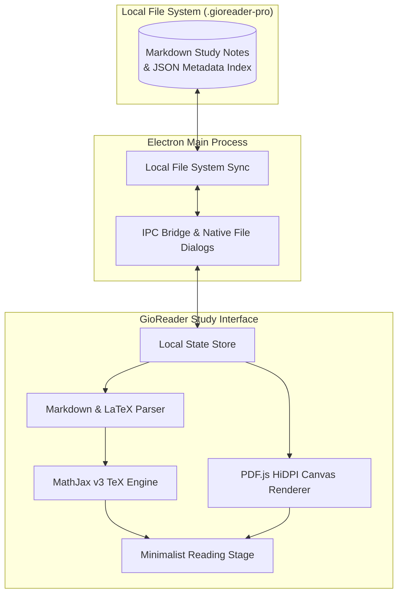

# GioReader Pro 📖⚡

[](LICENSE)
[](https://github.com/GioGorkem/gioreader-pro)
[](https://www.electronjs.org/)
[](https://www.mathjax.org/)
[](https://mozilla.github.io/pdf.js/)

> **An AI-assisted, local-first academic desktop reader designed to organize and study intensive university engineering coursework, LaTeX mathematical derivations, and high-DPI PDF problem sets.**

---

## 🎯 Background & Motivation

Studying core Computer Engineering courses at **METU (ODTÜ)**—such as *Data Structures (`CENG213`), Discrete Computational Structures (`CENG223`), Differential Equations (`MATH219`), Electrical Circuits (`EE281`), and Economics (`ECON210`)*—requires juggling hundreds of pages of mathematical proofs, C/C++ implementations, and vector PDF problem sets.

**GioReader Pro** was created through **AI-assisted rapid prototyping** as a personal desktop study environment to solve practical reading and organization challenges:
* **Seamless Markdown + LaTeX:** Reading structured lecture notes with native MathJax v3 equation rendering.
* **Crisp PDF Exploration:** Viewing supplementary problem sets and slides with high-DPI canvas supersampling (up to 800% zoom without blur) and smooth touchpad pan/zoom.
* **Hierarchical Course Tree:** Organizing courses into Units $\to$ Lecture Parts $\to$ Supplementary Problem Set PDFs.
* **Local-First Storage:** Keeping all study notes and JSON indices locally on disk with zero cloud dependency.

---

## ✨ Key Capabilities

1. **Ultra-HD HiDPI PDF Canvas:** Custom device-pixel-ratio supersampling over PDF.js with dedicated Web Workers and anchor-point touchpad zoom.
2. **Academic Mathematical Typesetting:** Native inline (`$...$`) and block (`$$...$$`) LaTeX rendering powered by MathJax v3.
3. **Structured Course & Unit Hierarchy:** Clean separation between linear lecture parts and tree-structured supplementary exercise PDFs.
4. **Offline-First File System Sync:** Instantaneous indexing and retrieval across 380+ lecture parts and 800,000+ words of study material.

---

## 🏛️ System Overview



---

## 🚀 Getting Started

### Prerequisites
* [Node.js](https://nodejs.org/) (v18+ recommended)

### Running Locally

```bash
# Clone the repository
git clone https://github.com/GioGorkem/gioreader-pro.git
cd gioreader-pro

# Install dependencies
npm install

# Start the desktop application
npm start
```

---

## ⌨️ Reading Controls

| Shortcut / Gesture | Action |
| :--- | :--- |
| `Ctrl + +` / `Ctrl + -` | Zoom in / Zoom out |
| `Ctrl + 0` | Reset zoom to 100% |
| `Ctrl + Wheel` / `Pinch` | Smooth cursor-anchored zoom |
| `Alt + Left` / `Alt + Right` | Previous / Next lecture part |
| `Ctrl + F` | In-document search |

---

## 📄 License

Licensed under the **MIT License** — see the [LICENSE](LICENSE) file for details.

---

## 👤 Author

**Görkem Akbulut**  
* Computer Engineering Student @ Middle East Technical University (METU)  
* GitHub: [@GioGorkem](https://github.com/GioGorkem)  
* LinkedIn: [linkedin.com/in/gorkem-akbulutt](https://www.linkedin.com/in/gorkem-akbulutt)
